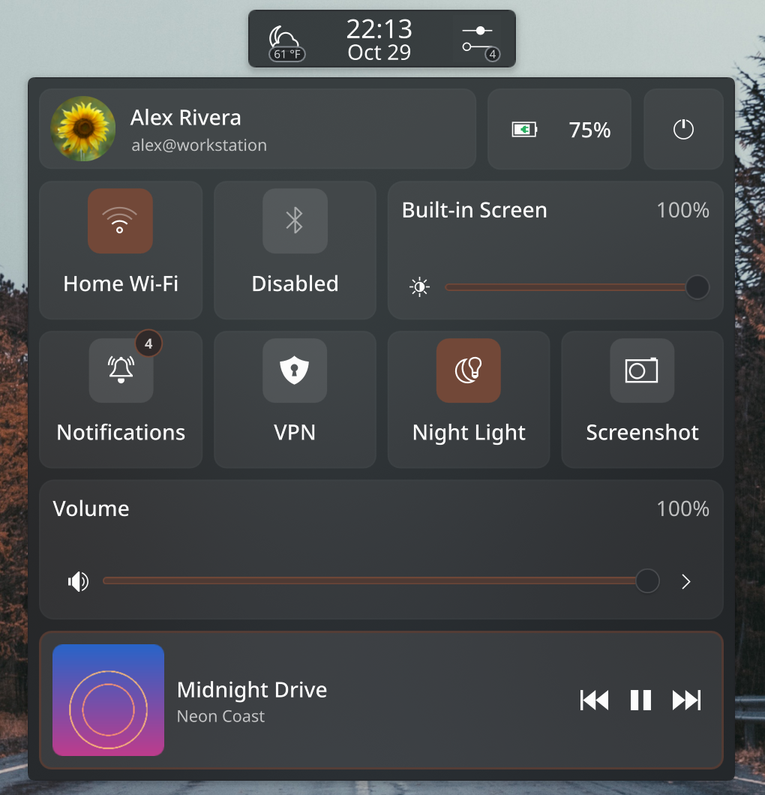
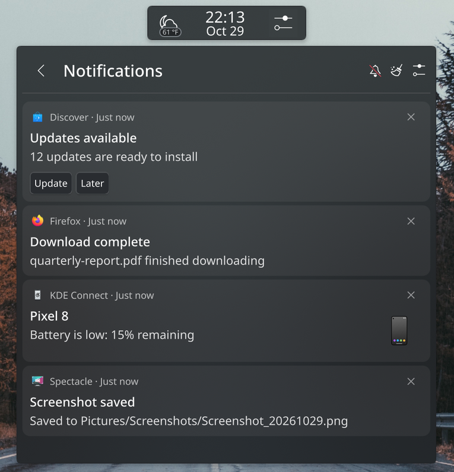
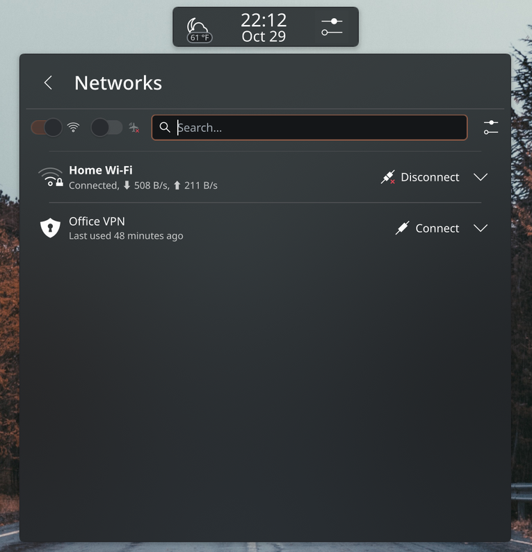
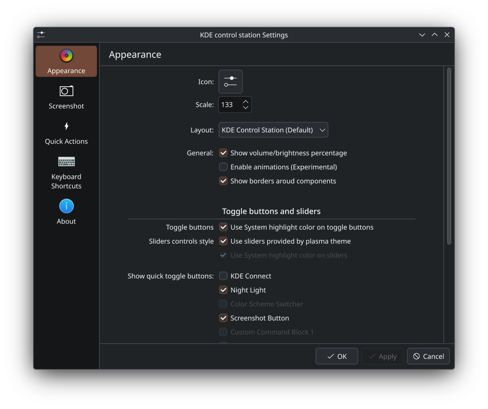

<div align="center">

# KDE Control Station

A control center for KDE Plasma 6, styled to blend in with Breeze and your color scheme.

This is a modified fork of [KDE Control Station](https://github.com/EliverLara/kde-control-station) by [Eliver Lara](https://github.com/EliverLara),
itself based on [kde_controlcentre](https://github.com/Prayag2/kde_controlcentre) by [Prayag2](https://github.com/Prayag2/).



</div>

## Changes in this fork

* **Breeze styling**: flat cards tinted from your color scheme, Breeze corner radii, accent-colored hover
  outlines and toggles, system fonts and spacing, native Plasma sliders, and icons from your icon theme
* **Notification center**: the widget runs Plasma's notification server itself, so notifications are listed
  in the widget instead of shown as popups. Unread counts appear on the Notifications tile and the panel icon,
  notifications keep their action buttons until dismissed, and Do Not Disturb, Clear All and notification
  settings are one click away
* **VPN tile**: toggles your most recently used VPN (WireGuard included); click the tile to see every network
* **Network list** rescans for nearby Wi-Fi networks while it's open

See [CHANGELOG.md](CHANGELOG.md) for details.

<div align="center">


</div>

## Features

* Prebuilt layouts, or build your own: reorder, add, delete and customize each widget
* Quick toggles for Wi-Fi, Bluetooth, VPN, Night Light and Do Not Disturb (click the icon to toggle,
  the rest of the tile for details)
* Pages for networks, Bluetooth devices, battery and power profiles, brightness, audio devices,
  media playback, notifications and session actions
* Dark/light color scheme switcher, optionally changing the global theme too
* Buttons that run custom commands

## Dependencies

- KDE Plasma 6
- Packages: `plasma-nm`, `plasma-pa`, `kdeplasma-addons`, `plasma-workspace`
- KDE Connect (optional)

## Installation

Install from a clone of this repository:

```sh
kpackagetool6 -t Plasma/Applet -i package    # first install
kpackagetool6 -t Plasma/Applet -u package    # after making changes
systemctl --user restart plasma-plasmashell
```

Then right-click your panel or desktop, choose **Add Widgets…** and add **KDE control station**.

Don't install or update the widget through the KDE Store or Discover: it has the same ID as the original,
so the store version would replace this fork.

### Notifications

Because this widget is the notification server, don't also run Plasma's own Notifications widget (it's part
of the System Tray); only one of them can receive notifications. If this widget is removed, notifications
stop working until a System Tray or Notifications widget is added back.

Notifications follow the per-application settings in **System Settings → Notifications**: apps set not to
show popups are hidden from the list.

## Credits

Original work by [Eliver Lara](https://github.com/EliverLara) and [Prayag2](https://github.com/Prayag2/).

## License

[GPLv3](https://www.gnu.org/licenses/gpl-3.0.en.html)
